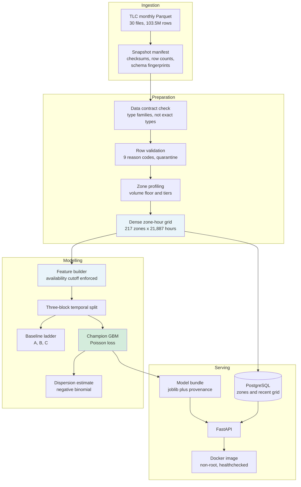
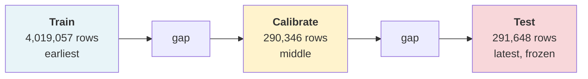

# UrbanFlow ML

Hourly taxi demand forecasting for New York City, from raw public trip records to
a deployed prediction API with measured uncertainty.

[](https://github.com/gbadedata/urbanflow-ml/actions/workflows/ci.yml)

The system predicts how many yellow taxi pickups will occur in each New York City
taxi zone during each of the next 1, 3 and 6 hours, and publishes a prediction
interval alongside every point forecast. It is built on 103.5 million trip records
covering 30 months, and every number reported below was measured on a test period
that was held back until the pipeline was complete.

---

## Contents

1. [Results at a glance](#1-results-at-a-glance)
2. [What problem this solves](#2-what-problem-this-solves)
3. [Quick start](#3-quick-start)
4. [System architecture](#4-system-architecture)
5. [Data source and window](#5-data-source-and-window)
6. [Validation and quarantine](#6-validation-and-quarantine)
7. [Which zones are forecastable](#7-which-zones-are-forecastable)
8. [The dense zone-hour grid](#8-the-dense-zone-hour-grid)
9. [Feature engineering and the availability rule](#9-feature-engineering-and-the-availability-rule)
10. [Evaluation design](#10-evaluation-design)
11. [Choosing the metric](#11-choosing-the-metric)
12. [Models](#12-models)
13. [Frozen test results](#13-frozen-test-results)
14. [The promotion gate and its exception](#14-the-promotion-gate-and-its-exception)
15. [Prediction intervals](#15-prediction-intervals)
16. [API reference](#16-api-reference)
17. [Deployment](#17-deployment)
18. [Testing strategy](#18-testing-strategy)
19. [Reproducing this project from scratch](#19-reproducing-this-project-from-scratch)
20. [Repository layout](#20-repository-layout)
21. [Command reference](#21-command-reference)
22. [Known limitations](#22-known-limitations)
23. [Defects found during development](#23-defects-found-during-development)
24. [Next iteration](#24-next-iteration)
25. [Sources](#25-sources)

---

## 1. Results at a glance

All figures come from a frozen test block of 291,648 zone-hours covering the most
recent eight weeks of the data window. That block was read once, after the
pipeline was complete and after the evaluation criteria were recorded in version
control.

| Model | MAE | Poisson deviance | WAPE | Volume bias |
|---|---|---|---|---|
| Seasonal naive | 6.888 | 9.023 | 0.247 | 1.003 |
| Hour-of-week median | 5.742 | 5.240 | 0.206 | 0.981 |
| Poisson regression | 5.500 | 2.626 | 0.197 | 1.010 |
| **Gradient boosting (shipped)** | **5.089** | **2.336** | **0.182** | **0.979** |

Horizon 1 hour, all zones pooled. Lower is better for the first three columns;
volume bias is best at 1.0.

The shipped model reduces Poisson deviance by 55.4% relative to the hour-of-week
median benchmark, and by 29.5% and 33.4% on the two demand tiers that carry 98%
of trip volume.

| Property | Value |
|---|---|
| Trip records processed | 103,563,330 |
| Records passing validation | 102,956,835 (99.41%) |
| Forecastable zones | 217 of 259 observed |
| Grid rows (zone-hours) | 4,749,479 |
| Training rows per horizon | 4,019,057 |
| Frozen test rows per horizon | 291,648 |
| Features per model | 19 |
| Automated tests | 228 |
| Interval coverage, high tier | 88.8% against a 90% target |

---

## 2. What problem this solves

A taxi operator positions vehicles before demand appears, not after. The useful
question is therefore not "how many pickups happened" but "how many should we
expect in zone Z during the next hour, and how confident should we be".

| Aspect | Decision |
|---|---|
| Prediction unit | One taxi zone during one clock hour |
| Horizons | 1, 3 and 6 hours ahead |
| Target | Count of yellow taxi pickups |
| Output | Point forecast plus a 90% prediction interval |
| Primary user | Operations planner or dispatch analyst |
| Explicit non-goal | Causal claims about weather, events or pricing |

The project is a forecasting system, not a causal study. It does not attempt to
explain why demand moves, only to anticipate where it will be.

---

## 3. Quick start

You need Python 3.12 or later, [uv](https://docs.astral.sh/uv/), Docker, and
about 2 GB of free disk space. On Windows, use WSL 2 and keep the project inside
the Linux filesystem rather than under `/mnt/c/`, because cross filesystem
input and output is roughly ten times slower and this pipeline reads gigabytes.

```bash
git clone https://github.com/gbadedata/urbanflow-ml.git
cd urbanflow-ml

# Install dependencies into a local virtual environment
uv sync --all-groups

# Confirm the installation
uv run pytest
uv run urbanflow config-show
```

To build everything from raw public data and serve forecasts locally:

```bash
make pipeline    # download, validate, build grid and features (about 40 minutes)
uv run urbanflow train
make db          # start PostgreSQL and load zones and recent history
make serve       # API on http://localhost:8000
```

Then open `http://localhost:8000/docs` for interactive documentation, or:

```bash
curl "localhost:8000/v1/forecast?zone_id=161&as_of=2025-06-25T14:00:00Z&horizon=1"
```

Section 19 explains every step in detail, including expected runtimes and what
each stage produces.

---

## 4. System architecture



| Layer | Technology | Responsibility |
|---|---|---|
| Ingestion | Python, httpx, PyArrow | Download, checksum, manifest |
| Transformation | DuckDB | Validation, grid construction, feature engineering |
| Analytical storage | Parquet | Full grid and feature tables |
| Serving storage | PostgreSQL | Zone registry and recent demand history |
| Modelling | scikit-learn | Baselines, gradient boosting, calibration |
| Intervals | SciPy | Negative binomial quantiles |
| API | FastAPI, Pydantic | Typed endpoints and generated OpenAPI |
| Runtime | Docker | Reproducible deployment |
| Continuous integration | GitHub Actions | Lint, types, tests, image build |

DuckDB does the heavy transformation work because the pipeline is analytical and
single node. PostgreSQL serves the API because the read pattern there is a small
indexed lookup, not a scan.

---

## 5. Data source and window

The source is the New York City Taxi and Limousine Commission trip record
dataset, published monthly as Parquet files. It is public, large, and imperfect,
which is the point: the data quality problems are real rather than simulated.

### Window selection

The pipeline uses **January 2023 through June 2025**, 30 monthly files. Two
hazards drove that choice, and both are reasons to exclude older data rather than
to include as much as possible.

| Hazard | Effect | Response |
|---|---|---|
| COVID period | Volumes fell roughly 90% and the hour-of-week shape changed | Exclude 2020 and 2021 entirely |
| Secular decline | Yellow taxi share has fallen steadily against for-hire vehicles | Start in 2023 so absolute levels transfer |

A model trained across a structural break learns an average of two regimes and
represents neither.

### Fields consumed

The classifier of a forecasting system is only as trustworthy as its inputs. Four
columns are read; everything else in the source is explicitly prohibited.

| Column | Role |
|---|---|
| `tpep_pickup_datetime` | Time index and target source |
| `PULocationID` | Prediction unit |
| `tpep_dropoff_datetime` | Quality control only, never a feature |
| `VendorID` | Provenance and duplicate signature |

Prohibited as features: fare amount, tip, tolls, total amount, payment type,
trip distance, rate code, dropoff location, and dropoff time. These are all
known only after a trip completes. Including any of them would mean forecasting
the future using the future.

### Schema changes across the window

The 30 files do not share one schema. Three eras exist.

| Boundary | Change | Consequence |
|---|---|---|
| 2023-01 to 2023-02 | `PULocationID` int64 becomes int32, `passenger_count` double becomes int64, `airport_fee` renamed `Airport_fee` | A real migration affecting a consumed column |
| 2024-12 to 2025-01 | `cbd_congestion_fee` added when congestion pricing began | Harmless, the column is not consumed |

The ingest manifest compares whole schema fingerprints and correctly reports this
window as inconsistent. That check is right but too blunt to act on, because it
fires for added fee columns that cannot possibly matter.

The data contract in `data_contracts/tlc_yellow_trips.yaml` therefore asserts
something narrower and more useful: that the four consumed columns exist with a
compatible **type family**. Any integer width satisfies an integer requirement,
so the zone identifier widening passes. A zone identifier shipped as text would
fail. Casting to canonical types happens explicitly in the validation SQL, so the
migration is visible in code rather than inferred by a reader.

### Snapshot provenance

Every experiment references a snapshot identifier derived from the SHA-256
checksums of the files it covers.

```
yellow-2023-01-2025-06-26c6cf6a154f
```

Two people downloading the same window produce the same identifier. A silently
revised upstream file produces a different one. Manifests live in
`data/manifests/` and are committed to version control; raw Parquet is not.

---

## 6. Validation and quarantine

Every row is either written to the validated corpus or quarantined with a reason
code. Rows are never dropped silently, and the pipeline exits with a non-zero
status if the arithmetic does not balance.

### Results across all 30 months

| Reason code | Rows | Share of input |
|---|---|---|
| `ZONE_EXCLUDED` | 601,691 | 0.5810% |
| `NEGATIVE_DURATION` | 3,011 | 0.0029% |
| `TS_OUT_OF_MONTH` | 1,258 | 0.0012% |
| `IMPLAUSIBLE_DURATION` | 525 | 0.0005% |
| `DUPLICATE` | 10 | 0.00001% |
| **Total quarantined** | **606,495** | **0.5856%** |
| **Passed** | **102,956,835** | **99.4144%** |

`TS_OUT_OF_MONTH` is worth noting: the published files genuinely contain rows
timestamped years away from the month they claim to cover.

### The conservation check

A validation step that removes rows without accounting for them is
indistinguishable from a bug. After validation the pipeline asserts:

```
rows_out + sum(reason_counts) == rows_in
```

per month, and fails loudly otherwise. This check caught a real defect during
development, described in section 23.

### Duplicate handling, and why the obvious approach is wrong

Only **10 duplicate rows** exist in 103.5 million records. That number matters,
because the intuitive deduplication signature for this dataset removes about
3 million rows and most of them are real trips.

Deduplicating on pickup time, zone and vendor seems reasonable until you consider
volume. Midtown sees a pickup roughly every 18 seconds. Two different cabs from
the same vendor collecting passengers in the same zone during the same second is
routine, not a data error. A signature that treats them as duplicates deletes
genuine demand, concentrated in exactly the busiest zones, and biases the target
downward where the model matters most.

The signature used here is a full row match including trip distance and total
amount. Those two columns are read for duplicate detection only and never reach a
model. Two rows identical on all of them are a genuine double submission.

### Daylight saving time

Timestamps are published as naive local wall clock time, which makes conversion
to UTC non-trivial twice a year.

| Transition | Situation | Treatment |
|---|---|---|
| Spring forward | Local 02:00 to 02:59 does not exist | Quarantined as `DST_NONEXISTENT` |
| Autumn fall back | Local 01:00 to 01:59 occurs twice | Both readings kept, resolved to the earlier |

Detection of nonexistent times uses a timezone round trip: a local time that does
not survive conversion to UTC and back did not exist. Without that check the
database silently shifts such times forward and they look valid forever after.
Zero rows were quarantined for this reason in the observed window, which is the
expected result since meters record real elapsed time.

---

## 7. Which zones are forecastable

The dataset contains 265 location identifiers. Not all of them are places a model
should predict, and the decision is empirical rather than assumed.

### Structural exclusions

| ID | Zone | 2024 pickups | Reason |
|---|---|---|---|
| 264 | Unknown | 122,200 | Placeholder, not a location |
| 265 | Outside of NYC | 24,001 | Placeholder, not a location |
| 1 | Newark Airport | 5,940 | Outside yellow cab pickup jurisdiction, about 16 per day |
| 103 | Governor's Island group | 0 | No pickups at all |
| 104 | Governor's Island group | 0 | No pickups at all |
| 105 | Governor's Island group | 4 | Four pickups in a year |

Three separate identifiers share one zone name for the island group, which is a
quirk of the source lookup table rather than a mistake.

### Volume floor

Of the 259 zones with any observed pickups, many are too sparse to support hourly
forecasting. One recorded a single pickup in all of 2024.

| Floor (pickups per hour) | Zones retained | Share of trips retained |
|---|---|---|
| 0 (no floor) | 259 | 100.00% |
| **0.1 (chosen)** | **216** | **99.98%** |
| 0.5 | 137 | 99.50% |
| 1.0 | 107 | 99.06% |
| 2.0 | 78 | 98.17% |

A floor of 0.1 removes 43 zones and costs 0.02% of trips. That trade is
unambiguous. Tightening further costs real volume for diminishing benefit, so
sparsity above the floor is handled by tiering rather than deletion.

The final registry, written to `reports/zone_registry.json` with the evidence
behind each decision, contains **217 forecastable zones** carrying 99.97% of
trips.

### Demand tiers

| Tier | Definition (mean pickups per hour) | Zones | Share of trips | Gated |
|---|---|---|---|---|
| High | 20 or more | 47 | Majority of volume | Yes |
| Medium | 2 to 20 | 31 | | Yes |
| Low | 0.1 to 2 | 138 | | Reported only |

High and medium together carry 98.17% of trips.

**Tiers are defined on the mean, not the median.** The original specification used
the median, and measurement showed that is unworkable: 152 of 259 zones average
under one pickup per hour, and because demand concentrates in daytime hours their
median hour is exactly zero. A median based rule would classify almost every zone
as low and erase the distinction the tiers exist to draw. The configuration
rejects `median` explicitly, with the reason recorded next to the validator.

---

## 8. The dense zone-hour grid

This is the single most consequential transformation in the project, and the one
most often got wrong.

**Trip records contain no row for an hour with no pickups.** A naive aggregation
silently omits those hours. Every lag, rolling window and error metric computed
downstream is then biased, and the bias is worst in exactly the low volume zones
where the model is weakest.

The canonical table is therefore a cross join of forecastable zones with every
hour in range, left joined to observed counts, with missing values filled to
zero:

```sql
WITH hours AS (
    SELECT UNNEST(generate_series(:start, :end, INTERVAL '1 hour')) AS hour_utc
),
grid AS (
    SELECT z.location_id, h.hour_utc
    FROM zones z CROSS JOIN hours h
)
SELECT g.location_id, g.hour_utc, COALESCE(o.n, 0) AS pickup_count
FROM grid g
LEFT JOIN observed o
  ON o.location_id = g.location_id AND o.hour_utc = g.hour_utc;
```

Absence of a trip record is evidence of zero demand, not absence of evidence.

### Grid properties

| Property | Value |
|---|---|
| Zones | 217 |
| Hours | 21,887 |
| Rows | 4,749,479 |
| Expected rows (zones times hours) | 4,749,479 |
| Rows that are genuine zeros | 2,180,828 (45.92%) |
| Total pickups represented | 102,929,915 |
| Span | 2023-01-01 05:00 UTC to 2025-07-01 03:00 UTC |

The density assertion is a release blocker with zero tolerance. If the row count
is not exactly zones times hours, the command exits non-zero.

### Storing UTC removes a whole class of bug

Hours are generated in UTC, which makes the series uniform. There is no 23 hour
or 25 hour day to special case, because those exist only in local time. Daylight
saving affects locally derived calendar features, which are computed downstream
and never change the grid's shape. A test asserts that 10 March 2024, a 23 hour
day locally, still produces exactly 24 rows per zone.

### Distinguishing three kinds of zero

| Case | Meaning | Treatment |
|---|---|---|
| True zero | Zone active, no pickups that hour | Real data, kept |
| DST fold artifact | Ambiguous local times all resolved to one UTC hour, leaving the other empty | Excluded, expected once per year |
| Ingestion gap | Upstream publication failure | Excluded, investigated |

An hour where every zone in the city reports zero is never a quiet night. Two
such hours exist in the window, both classified as daylight saving artifacts, and
**zero ingestion gaps** were found.

---

## 9. Feature engineering and the availability rule

### The rule

At prediction time, only data that has actually arrived may be used. This sounds
obvious and is routinely violated, because historical data is complete and
therefore invites the assumption that live data will be too.

The system assumes an operator internal trip feed with **15 minutes of latency**.
Historical records simulate that feed. Under that assumption the most recent
fully arrived hour is:

```
anchor = floor_hour(as_of - 15 minutes) - 1 hour
```

The subtraction of a whole hour is the part usually missed. At `as_of = 14:00`,
the hour 13:00 to 13:59 has not finished. The hour 12:00 to 12:59 finished at
13:00 and its records were complete by 13:15. So the newest usable observation is
**12:00, two hours behind the forecast origin**, not one.

```mermaid
gantt
    title Availability at as_of 14:00, horizon 1 hour
    dateFormat HH:mm
    axisFormat %H:%M

    section Usable
    Hour 11 complete      :done, h11, 11:00, 1h
    Hour 12 complete      :done, h12, 12:00, 1h

    section Not usable
    Hour 13 incomplete    :crit, h13, 13:00, 1h
    Origin 14:00          :milestone, origin, 14:00, 0m

    section Target
    Hour 15 predicted     :active, h15, 15:00, 1h
```

For an origin on the hour with horizon `h`, this reduces to a constant offset:

```
anchor = target_hour - (h + 2) hours
```

| Horizon | Anchor offset | Consequence |
|---|---|---|
| 1 hour | target minus 3 hours | No lag-1h feature exists |
| 3 hours | target minus 5 hours | Recent history is staler |
| 6 hours | target minus 8 hours | Recent history is staler still |

**A lag-1h feature is impossible under any positive latency.** It would require
data that has not arrived. That is precisely the leakage which makes a naive
backtest look excellent and a deployed model fail.

### The two feature families

| Family | Anchored on | Rationale |
|---|---|---|
| Recent history | Availability | Cannot use data that has not arrived |
| Seasonal history | Target hour | Same clock hour on earlier days is old enough to have arrived regardless of horizon |

Seasonal features carry the diurnal and weekly signal that recent lags cannot.

### The 19 features

| Feature | Definition |
|---|---|
| `recent_1`, `recent_2`, `recent_3` | Demand in the three most recent available hours |
| `lag_24h`, `lag_48h`, `lag_168h` | Same clock hour one day, two days and one week earlier |
| `roll_mean_3h`, `roll_mean_24h`, `roll_mean_168h` | Rolling means over windows ending at the anchor |
| `zero_rate_168h` | Share of the past week with zero demand |
| `how_median_4w` | Trailing four week median for this zone and hour of week |
| `local_hour`, `local_dow`, `local_month` | Calendar position in New York local time |
| `is_weekend` | Weekend indicator |
| `hour_sin`, `hour_cos`, `dow_sin`, `dow_cos` | Cyclical encodings |

`how_median_4w` is both a feature and Baseline B, computed from one code path so
the benchmark and the feature cannot drift apart.

### Warm-up trimming

Rows without complete history are removed, and a null check alone is insufficient
to find them. Two database behaviours produce plausible values from incomplete
inputs:

- `list_median` ignores null elements, so a four week median silently returns a
  one week median while only one week of history exists.
- `ROWS BETWEEN` aggregates over however many rows are present, so a 168 hour
  rolling mean silently becomes a 20 hour mean near the series start.

Both return non-null numbers that mean something different from the same column
later. Since the affected rows are the earliest data, that distribution shift
lands squarely in the training block. Rows are therefore trimmed by **required
history**, 672 hours per zone, not by nullness.

| Stage | Rows per horizon |
|---|---|
| Dense grid | 4,749,479 |
| After warm-up trim (217 zones times 672 hours) | 4,603,655 |

### Training and serving must agree

Training computes features with SQL window functions across the whole grid.
Serving computes the same vector in NumPy from a point lookup. Two
implementations of one definition is how a model silently degrades: predictions
keep arriving, the API keeps returning 200, and accuracy quietly decays.

Both paths draw their offsets from the same `FeatureSpec` object, and a test
suite runs the real training builder over a synthetic grid then asserts the
serving path reproduces all 19 columns to within 1e-9, across three horizons,
four times of day, and a daylight saving boundary.

---

## 10. Evaluation design

### Three blocks, not two



| Block | Rows | Used for |
|---|---|---|
| Train | 4,019,057 | Model fitting only |
| Gap | 2,604 (discarded) | Separation |
| Calibrate | 290,346 | Model selection, dispersion fitting, threshold choice |
| Test | 291,648 | Read once, at release |

Two blocks would not be enough. Fitting calibration and selecting a threshold on
the same rows overfits the threshold and produces an optimistic coverage curve.

### Why gaps exist

Without a gap, the last training rows and the first validation rows share
seasonal lags drawn from the same hours. The gap is at least the longest forecast
horizon, so a target in one block cannot be a feature in another. Rows falling
inside a gap are labelled null and excluded from every block.

### Freezing the test block

The test block was not read until the entire pipeline was complete, the metric
choice was recorded in version control, and the serving layer was working. The
command that reads it requires an explicit `--frozen-test` flag and prints a
warning. The git history shows the sequence.

### Leakage controls

| Control | Implementation |
|---|---|
| Temporal split only | Random splitting is impossible in the code path |
| Availability cutoff | Enforced in the feature builder, covered by unit tests |
| No post-trip fields | Contract declares prohibited columns, asserted by test |
| Scalers fitted in fold | Fitted inside the training call only |
| Rolling windows exclude their target | Test seeds an outlier and asserts the window does not absorb it |
| Test read once | Explicit flag, warning printed, separate report file |

---

## 11. Choosing the metric

The baseline results produced two metrics that disagreed about which model was
better. Resolving that disagreement was the most consequential decision in the
project, and it was recorded in `reports/gate_decision.md` **before any champion
model was trained**.

### The disagreement

Against the hour-of-week median benchmark on the calibrate block, the Poisson
regression improved mean absolute error by 2.8% but Poisson deviance by 49.3%. In
the low tier it was worse on MAE and far better on deviance.

The cause is structural. **MAE is minimised by the conditional median; Poisson
deviance by the conditional mean.** Hourly counts are right skewed and 45.9% of
the grid is zero, so for sparse zones the median sits well below the mean.
Baseline B is literally a trailing median, so it is near optimal for MAE by
construction.

At higher demand rates a Poisson median and mean coincide on the integers, which
makes this specifically a sparse demand effect. 138 of 217 zones are in the low
tier.

### What settled it

Volume bias, the ratio of total predicted demand to total actual demand, which
neither MAE nor WAPE can see.

| Model | High | Medium | Low |
|---|---|---|---|
| Hour-of-week median | 0.979 | 0.929 | **0.879** |
| Poisson regression | 1.001 | 0.989 | 0.993 |

The median baseline forecasts 12.1% fewer pickups than actually occur in low
demand zones while posting the better MAE. It achieves its error advantage by
predicting the typical hour well and consistently missing demand overall.

For positioning vehicles, that is the failure that matters. A dispatcher acting
on it under-supplies the outer boroughs every day, and no absolute error metric
would ever reveal it.

### The decision

| Criterion | Value |
|---|---|
| Promotion metric | Mean Poisson deviance |
| Threshold | 10% relative improvement over Baseline B |
| Gated tiers | High and medium |
| Volume bias constraint | Within 5% in every tier |
| Tier degradation limit | No tier worse by more than 10% |
| Metrics reported but not gated | MAE, WAPE, RMSE, zero-hit rate |

Under the original wording, a 10% MAE improvement over Baseline B, no model was
ever going to pass, because MAE structurally favours a median predictor on sparse
count data. Discovering that after seeing a champion's results and then changing
the metric would be indistinguishable from moving the goalposts. It was found
from the baselines, which is why the decision carries an earlier commit than any
champion result.

---

## 12. Models

### The baseline ladder

| Tier | Model | Role |
|---|---|---|
| A | Seasonal naive, demand at the same hour last week | Sanity floor, reported but never the gate |
| B | Hour-of-week trailing median over four weeks | **The benchmark the champion must beat** |
| C | Poisson regression on the full feature set | Interpretable statistical reference |
| Champion | Gradient boosting with Poisson loss | Ships only if it clears the gate |

Baseline A is deliberately not the gate. A single noisy observation is beaten by
a gradient booster by 30 to 50% almost regardless of quality. A benchmark that
cannot be failed measures nothing.

Baseline B is cheap, strong, and genuinely hard to beat in stable zones.

### Why demand features are log transformed

Poisson regression uses a log link, so a prediction is `exp(b · x)`. Feeding raw
counts in makes demand enter the exponent multiplicatively: a zone at 200 pickups
per hour contributes `exp(200b)`, which saturates or explodes depending on sign,
and the fitted coefficient ends up dominated by the largest zones.

Applying `log1p` first makes the model `exp(b · log(1+x))`, which is `(1+x)^b`, a
power law in demand. That is the right shape for a count process and lets one
pooled model span zones differing by three orders of magnitude.

The measured effect on synthetic data spanning 0.8 to 150 pickups per hour:

| Specification | MAE | Deviance | Quiet zone mean prediction (actual 0.805) |
|---|---|---|---|
| Raw counts | 9.332 | 5.066 | 3.564 |
| `log1p` transformed | 4.222 | 1.497 | 1.235 |

The same transform is applied to the gradient booster. Trees are invariant to
monotone transforms of a single feature, so it does not change which splits are
reachable, but it keeps the two models comparable on identical inputs.

### Champion configuration

| Parameter | Value | Reason |
|---|---|---|
| Loss | Poisson | Matches the target and the gate metric |
| Boosting iterations | 400 | Early stopping never triggered, so this is a cap |
| Learning rate | 0.1 | |
| Maximum leaf nodes | 63 | |
| Minimum samples per leaf | 100 | |
| L2 regularisation | 1.0 | |
| Categorical features | `local_hour`, `local_dow`, `local_month` | Hour 23 is adjacent to hour 0, so a threshold split is meaningless |
| Random state | 0 | Determinism is asserted by test |

Cyclical sine and cosine encodings remain available alongside the categorical
treatment, so the model can use whichever representation helps.

---

## 13. Frozen test results

291,648 zone-hours, the most recent eight weeks of the window, read once.

### Horizon 1 hour

| Model | Tier | MAE | Deviance | WAPE | Bias |
|---|---|---|---|---|---|
| Seasonal naive | all | 6.888 | 9.023 | 0.247 | 1.003 |
| | high | 23.549 | 10.756 | 0.208 | 1.005 |
| | medium | 5.112 | 5.802 | 0.400 | 0.987 |
| | low | 1.521 | 9.281 | 0.759 | 0.987 |
| Hour-of-week median | all | 5.742 | 5.240 | 0.206 | 0.981 |
| | high | 19.760 | 7.280 | 0.174 | 0.994 |
| | medium | 4.193 | 3.276 | 0.328 | 0.912 |
| | low | 1.241 | 5.053 | 0.619 | 0.848 |
| Poisson regression | all | 5.500 | 2.626 | 0.197 | 1.010 |
| | high | 18.752 | 6.058 | 0.165 | 1.011 |
| | medium | 4.038 | 2.328 | 0.316 | 1.005 |
| | low | 1.244 | 1.503 | 0.621 | 1.000 |
| **Gradient boosting** | **all** | **5.089** | **2.336** | **0.182** | **0.979** |
| | **high** | **17.198** | **5.132** | **0.152** | **0.982** |
| | **medium** | **3.818** | **2.180** | **0.299** | **0.945** |
| | **low** | **1.183** | **1.397** | **0.591** | **0.983** |

### Champion across horizons

| Horizon | Tier | MAE | Deviance | WAPE | Bias | Deviance improvement over B |
|---|---|---|---|---|---|---|
| 1h | all | 5.089 | 2.336 | 0.182 | 0.979 | +55.4% |
| | high | 17.198 | 5.132 | 0.152 | 0.982 | +29.5% |
| | medium | 3.818 | 2.180 | 0.299 | 0.945 | +33.4% |
| | low | 1.183 | 1.397 | 0.591 | 0.983 | +72.4% |
| 3h | all | 5.189 | 2.417 | 0.186 | 0.978 | +53.9% |
| | high | 17.604 | 5.404 | 0.155 | 0.981 | +25.8% |
| | medium | 3.866 | 2.256 | 0.303 | 0.941 | +31.1% |
| | low | 1.191 | 1.413 | 0.594 | 0.983 | +72.0% |
| 6h | all | 5.232 | 2.449 | 0.187 | 0.980 | +53.3% |
| | high | 17.782 | 5.529 | 0.157 | 0.983 | +24.0% |
| | medium | 3.880 | 2.263 | 0.304 | 0.946 | +30.9% |
| | low | 1.194 | 1.418 | 0.596 | 0.983 | +71.9% |

### Two observations worth stating

**Horizon barely matters.** MAE moves from 5.089 to 5.232 between a one hour and a
six hour horizon, a degradation of under 3%. Most of the predictable signal in
taxi demand is weekly periodicity rather than short term momentum. That has a
practical implication: forecasting six hours ahead is nearly as accurate as one
hour ahead, which is convenient for operational planning.

**Test results are worse than calibrate, as they should be.** Champion MAE on the
calibrate block was 4.597 against 5.089 on test. That gap is temporal validation
doing its job. Results that matched perfectly would suggest the split was not
doing any work.

---

## 14. The promotion gate and its exception

**The gate failed, and the champion shipped anyway under a recorded exception.**
This section explains why, and the full record is in `reports/gate_exception.md`.

### What the gate decided

The champion cleared the deviance threshold on every gated tier and horizon, by
24% to 33% against a 10% requirement. It was then blocked by the volume bias
constraint: medium tier came in at 0.945, 0.941 and 0.946 against a tolerance of
5%. It missed by roughly half a percentage point.

### Why that outcome was wrong

The gate's fallback is Baseline B, and Baseline B is more biased than the model
it was preferred over.

| Model | MAE | Deviance | Bias | Bias error |
|---|---|---|---|---|
| Baseline B (would ship) | 4.193 | 3.276 | 0.912 | **8.8%** |
| Champion (blocked) | 3.818 | 2.180 | 0.945 | **5.5%** |

Medium tier, horizon 1 hour. The champion is better on every measured dimension,
including the one that blocked it. Applying the rule literally would ship a model
that under-forecasts medium volume demand by 8.8% in order to avoid one that
under-forecasts by 5.5%.

The defect is in the gate, not in the models. The constraint was written as an
absolute bound on the champion while implicitly assuming the fallback was
unbiased. It is not. The pre-registered rule is silent on the case where both
candidates violate the same constraint, and keeping the baseline is not a valid
resolution of it.

### What was done

The champion ships for all three horizons under an exception that is recorded,
dated after the frozen read, and stated prominently rather than buried.

**The threshold was not changed and the frozen block was not read a second time.**
Editing a gate with results visible and re-running is indistinguishable from
moving the goalposts.

### The corrected gate, pre-registered for the next release

The volume bias constraint becomes comparative. A champion passes when either its
bias is within the absolute tolerance, **or** its bias is no worse than the model
it replaces. A promotion that reduces bias cannot sensibly be blocked for bias.
The absolute bound is retained so a model cannot ship indefinitely on the strength
of a worse incumbent.

This is implemented as gate version 2 with four tests, one using the actual
measured figures. It applies from the next release against a block not yet read,
and is deliberately not applied retroactively.

---

## 15. Prediction intervals

Every forecast carries a 90% interval. Three approaches were considered and two
were rejected after measurement.

| Approach | Outcome |
|---|---|
| Split conformal | Rejected before implementation: assumes exchangeability, which a time series violates |
| Quantile gradient boosting | Implemented, measured, **abandoned** |
| Negative binomial around the mean | Shipped |

### Why quantile regression failed here

With 46% of the grid at zero demand, pinball loss at the 0.05 quantile starts
from the pooled fifth percentile, which is zero, and never escapes it. Any upward
step is charged 0.95 against every zero observation. The result was a lower bound
pinned at zero even in zones averaging 100 pickups per hour.

**Total coverage looked fine at 94.7% against a 90% target.** The interval had
silently become the one-sided `[0, p95]`, whose true nominal coverage is 95%. It
passed its gate for the wrong reason, and the only visible symptom was that the
proportion of actuals falling below the lower bound was exactly 0.0% in every
tier.

### What shipped instead

The champion already produces a well calibrated mean, so intervals follow from
the count distribution around it. No second model is required.

Counts are overdispersed: variance exceeds the mean because demand responds to
factors the features do not capture. Poisson intervals therefore under-cover badly
at high volume. A negative binomial with a single dispersion parameter `k`,
estimated by moment matching on the calibrate block, corrects this.

```
Var = mu + mu^2 / k        k measured at approximately 32
```

At 100 pickups per hour that gives a standard deviation near 19 rather than the
10 a Poisson assumption would predict. The parameter is worth reporting in its own
right: it quantifies how much variability the features do not explain.

### Measured coverage on the frozen test block

| Horizon | Tier | Coverage | Mean width | Below lower | Above upper |
|---|---|---|---|---|---|
| 1h | all | 92.1% | 20.11 | 2.3% | 5.6% |
| | high | 88.8% | 71.66 | 4.9% | 6.3% |
| | medium | 87.0% | 12.71 | 4.1% | 8.8% |
| | low | 94.6% | 4.01 | 0.9% | 4.5% |
| 3h | high | 88.4% | 72.57 | 5.1% | 6.5% |
| | medium | 86.6% | 12.73 | 4.1% | **9.3%** |
| 6h | high | 88.0% | 72.61 | 5.3% | 6.7% |
| | medium | 86.4% | 12.76 | 4.3% | **9.3%** |

Nominal is 90% coverage with 5% in each tail.

### Both tails are checked, not just total coverage

An interval whose lower bound sits at zero never misses below, so it can report
95% coverage while conveying nothing about the downside. Minimum staffing
decisions taken against such a bound would be badly wrong. Each tail is therefore
checked against its own nominal rate, and that check is what rejects the
degenerate case described above.

### Where the intervals are weak

**The coverage gate fails at 3 and 6 hours.** In medium volume zones, 9.3% of
actuals exceed the upper bound against 5% expected. The intervals are too tight
on the upside there.

The diagnosis is that a single global dispersion parameter is too coarse.
Variance relative to the mean differs across demand tiers, and one parameter
fitted across all of them fits the high tier acceptably at the expense of the
medium.

No fix is applied in this release, because evaluating one would require reading
the frozen block a second time. Anyone planning against the upper bound in medium
volume zones should treat it as optimistic by roughly four percentage points.

---

## 16. API reference

Interactive documentation is generated from the Pydantic schemas and served at
`/docs`.

### `GET /v1/forecast`

| Parameter | Type | Description |
|---|---|---|
| `zone_id` | integer | TLC taxi zone LocationID |
| `as_of` | ISO 8601 datetime | Forecast origin, UTC |
| `horizon` | integer | Hours ahead: 1, 3 or 6 |

```bash
curl "localhost:8000/v1/forecast?zone_id=161&as_of=2025-06-25T14:00:00Z&horizon=1"
```

```json
{
    "zone_id": 161,
    "as_of": "2025-06-25T14:00:00Z",
    "target_hour": "2025-06-25T15:00:00Z",
    "horizon_hours": 1,
    "forecast": 356.888,
    "lower_p05": 257.0,
    "upper_p95": 470.0,
    "model_version": "h1-26c6cf6a154f-20260807",
    "feature_cutoff_minutes": 15,
    "anchor_hour": "2025-06-25T12:00:00Z",
    "generated_at": "2026-08-07T16:59:14.269387Z"
}
```

Zone 161 is Midtown Center. The anchor at 12:00 UTC is exactly three hours before
the 15:00 target, which is the availability rule made visible in the response. A
consumer can see which model produced the number and what feed latency it
assumed.

### Other endpoints

| Endpoint | Returns |
|---|---|
| `GET /v1/zones` | Forecastable zones with borough, name and demand tier |
| `GET /v1/model` | Model versions, snapshot identifier, training window, dispersion, feature list |
| `GET /health` | Process liveness, deliberately does not touch the database |
| `GET /ready` | Model, database and grid readiness |

### Error contracts

| Status | Condition | Example detail |
|---|---|---|
| 404 | Zone unknown or below the volume floor | `zone 999 is not forecastable` |
| 400 | Horizon not served | `available horizons are [1, 3, 6]` |
| 422 | Insufficient history for the requested origin | `zone 161 has 340 of 700 required hours` |
| 422 | Malformed parameter | Standard Pydantic validation detail |

Missing history raises rather than filling zeros. The grid is dense by
construction, so a gap means the database is incomplete, and substituting zeros
would fabricate the demand history the forecast depends on.

### Refusing an incompatible model

A model bundle records the availability cutoff it was trained under. If the
runtime is configured differently, loading fails with an explanatory error rather
than serving predictions whose features mean something other than what the model
learned.

---

## 17. Deployment

### Container

The image is built in two stages. The builder installs dependencies into a
virtual environment; the runtime copies only that environment and the
application, so build tools and caches never ship.

| Property | Value |
|---|---|
| Base image | `python:3.12-slim` |
| User | Non-root (`urbanflow`) |
| Dependency resolution | `uv sync --frozen` from a committed lockfile |
| Model artefacts | Baked into the image |
| Healthcheck | `GET /health` with a 20 second start period |

Model artefacts are baked in rather than mounted so the image carries the exact
model it was tested with and a rollback is a single image tag.

The healthcheck targets `/health` rather than `/ready` deliberately. Liveness
should not fail because a database is briefly unreachable, or the orchestrator
restarts a perfectly healthy process.

### Local deployment

```bash
make image
docker compose --profile api up -d --build
curl localhost:8000/health
```

The API service sits behind a compose profile, so ordinary development brings up
PostgreSQL alone and leaves the API running from the working tree with reload.

### Serving database size

Serving reads a fixed window of history per zone, never the whole grid.

| Load mode | Rows | Suitable for |
|---|---|---|
| `--recent-hours 1000` (default) | 217,000 | Free tier PostgreSQL |
| `--recent-hours 0` | 4,749,479 | Local analysis |

The full grid stays in Parquet for training. Loading everything into the serving
database would waste storage that free tier providers do not have.

### Cloud deployment

`fly.toml` configures scale to zero: no cost while idle, at the price of a cold
start on the first request after a quiet period. That trade is deliberate for a
demonstration service and is stated here rather than hidden.

```bash
fly secrets set DATABASE_URL="postgresql+psycopg://..."
uv run urbanflow load-db          # against the remote database
fly deploy
```

Any managed PostgreSQL works. The repository assumes nothing beyond a connection
string in `DATABASE_URL`.

---

## 18. Testing strategy

228 tests across four layers. Continuous integration runs lint, format check,
strict type checking and the full suite, then builds the container image and
asserts it starts and answers a liveness probe.

| Layer | Count | Covers |
|---|---|---|
| Unit | Majority | Manifests, contracts, validation rules, grid construction, features, metrics, gate logic, intervals |
| Integration | Several | Pipeline wiring between components |
| Contract | 17 | API behaviour against a real database and real fitted models |
| Parity | 14 | Training and serving feature agreement |

### Tests that exist because something went wrong

| Test | Guards against |
|---|---|
| Row conservation | Rows disappearing between validation and output |
| Timezone independence | Host locale changing pipeline results |
| Concurrent trips survive deduplication | Real demand deleted as duplicates |
| Warm-up trim removes exactly 672 hours per zone | Partially formed features entering training |
| Interval tail calibration | One-sided intervals passing a coverage gate |
| CLI flag reaches the model | Options renaming outputs without changing behaviour |
| Training and serving parity | Silent model degradation in production |

### Notable test designs

**The leak test.** Seed a grid where one hour has 9,999 pickups and every other
hour has 5, then assert the rolling means at that hour are exactly 5.0. If a
window absorbed its own target, that value moves. It is the cheapest possible
check for the most common error in time series work.

**The timezone test.** Build the same grid under three different host timezones
and assert the results are identical.

**The wiring test.** Read a CLI function's own source and assert that the flag is
passed through to the evaluator. Unusual, and it exists because a flag once
renamed an output file without ever reaching the model.

---

## 19. Reproducing this project from scratch

Every step below is deterministic given the same source snapshot. Timings are
from a laptop with 6 cores and 16 GB of RAM running under WSL 2.

### Prerequisites

| Requirement | Notes |
|---|---|
| Python 3.12 or later | Installed automatically by uv |
| uv | `curl -LsSf https://astral.sh/uv/install.sh \| sh` |
| Docker | For PostgreSQL and the container build |
| Disk space | About 2 GB for raw Parquet plus derived tables |
| Network | About 1.5 GB downloaded once |

On Windows, use WSL 2 and clone into the Linux filesystem. Working under
`/mnt/c/` makes every read roughly ten times slower.

### Step 1: install

```bash
git clone https://github.com/gbadedata/urbanflow-ml.git
cd urbanflow-ml
uv sync --all-groups
uv run pytest
```

Expect 228 passing tests in about 12 seconds. If this fails, nothing later will
work.

### Step 2: review the configuration

```bash
uv run urbanflow config-show
```

`configs/config.yaml` holds every decision the pipeline depends on: the date
window, excluded zones, the availability cutoff, horizons, split sizes, tier
boundaries and gate criteria. Each value carries a comment explaining the
evidence behind it. Changing any of them invalidates existing snapshots and
trained models.

### Step 3: download the source data

```bash
uv run urbanflow ingest
```

**Runtime: 15 to 40 minutes.** Downloads 30 monthly Parquet files, roughly 1.5 GB,
and writes a snapshot manifest with checksums, row counts and schema
fingerprints. Idempotent: interrupting and re-running skips completed files.
Partial downloads are written to temporary paths and moved into place only on
success, so an interrupted run never leaves a truncated file that looks complete.

Expect `schema consistent: False`. That is correct and explained in section 5.

### Step 4: check the contract

```bash
uv run urbanflow contract-check
```

**Runtime: seconds.** Reads footer metadata only. Verifies that all 30 files carry
the four consumed columns with compatible types.

### Step 5: validate

```bash
uv run urbanflow validate
```

**Runtime: 5 to 15 minutes.** Casts across schema eras, applies nine validation
rules, writes the validated corpus and a quarantine file with reason codes, and
asserts row conservation per month. Expect roughly 0.59% quarantined.

### Step 6: profile zones

```bash
uv run urbanflow zone-report
```

**Runtime: under a minute.** Applies the volume floor, assigns demand tiers, and
writes `reports/zone_registry.json` with the evidence for every inclusion and
exclusion. Expect 217 forecastable zones.

### Step 7: build the grid

```bash
uv run urbanflow build-grid
```

**Runtime: 1 to 3 minutes.** Constructs the dense zone-hour grid and asserts it
contains exactly zones times hours rows. Exits non-zero if not. Also classifies
city-wide zero hours as daylight saving artifacts or ingestion gaps.

### Step 8: build features

```bash
uv run urbanflow build-features
```

**Runtime: 1 to 2 minutes.** Produces one feature table per horizon with the
availability cutoff enforced, then asserts no feature reads data newer than the
anchor. Expect 4,603,655 rows and 19 features per horizon.

### Step 9: evaluate baselines

```bash
uv run urbanflow baselines --champion
```

**Runtime: 5 to 15 minutes.** Fits all four models and applies the promotion gate
on the **calibrate** block. The frozen test block is untouched unless
`--frozen-test` is passed.

### Step 10: train and persist

```bash
uv run urbanflow train
```

**Runtime: 5 to 15 minutes.** Fits a champion per horizon, estimates dispersion on
the calibrate block, and writes model bundles to `models/` with a JSON sidecar
recording provenance.

### Step 11: load the serving database

```bash
cp .env.example .env
docker compose up -d postgres
uv run urbanflow load-db
```

**Runtime: 1 to 2 minutes.** Applies the schema and loads the zone registry plus
the most recent 1,000 hours per zone.

### Step 12: serve

```bash
uv run urbanflow serve
```

Open `http://localhost:8000/docs`.

### The whole pipeline

```bash
make pipeline    # steps 3 to 8
uv run urbanflow train
make db
make serve
```

### Reading the frozen test block

```bash
uv run urbanflow baselines --champion --frozen-test
uv run urbanflow intervals --frozen-test
```

**Do this once.** The value of a held out block is destroyed by repeated reads.
If you are rebuilding this project to learn from it, run everything on calibrate
until you are finished, then read test once and report whatever you find.

---

## 20. Repository layout

```
urbanflow-ml/
├── configs/
│   └── config.yaml              Every locked decision, with evidence in comments
├── data_contracts/
│   └── tlc_yellow_trips.yaml    Required columns, prohibited columns, rule codes
├── sql/
│   └── schema.sql               PostgreSQL DDL with constraints encoding spec rules
├── src/urbanflow/
│   ├── config.py                Typed configuration with validating invariants
│   ├── duck.py                  DuckDB connections pinned to UTC
│   ├── cli.py                   Command line entry points
│   ├── ingest/                  Source discovery, download, snapshot manifests
│   ├── validation/              Contract, row rules, quarantine, zone profiling
│   ├── features/                Dense grid and feature construction
│   ├── models/                  Split, metrics, baselines, champion, intervals, persistence
│   ├── serving/                 Repository, serving features, FastAPI application
│   └── monitoring/              Reserved for the next iteration
├── tests/
│   ├── unit/                    Component behaviour
│   ├── integration/             Wiring between components
│   └── contract/                API behaviour against a real database
├── reports/
│   ├── gate_decision.md         Metric choice, recorded before any champion ran
│   ├── gate_exception.md        Post-hoc exception, recorded after the frozen read
│   ├── zone_registry.json       Forecastability decision with evidence
│   ├── data_quality/            Validation results per month
│   ├── grid_stats.json          Grid shape and density
│   ├── feature_summary.json     Feature list and anchor offsets per horizon
│   ├── champion_test.json       Frozen test results
│   └── intervals_test.json      Frozen coverage results
├── docker/Dockerfile            Multi-stage, non-root, healthchecked
├── docker-compose.yml           PostgreSQL always, API behind a profile
├── fly.toml                     Scale to zero deployment
└── Makefile                     Common workflows
```

Raw data, derived tables and model artefacts are not committed. Manifests,
registries and reports are, because they are the evidence.

---

## 21. Command reference

| Command | Purpose |
|---|---|
| `urbanflow config-show` | Print resolved configuration and implied files |
| `urbanflow ingest` | Download the window and write a snapshot manifest |
| `urbanflow contract-check` | Verify all files against the data contract |
| `urbanflow validate` | Validate rows, quarantine failures, write the quality report |
| `urbanflow zone-report` | Profile zone volumes and write the registry |
| `urbanflow build-grid` | Build the dense grid and assert density |
| `urbanflow build-features` | Build feature tables and assert no leakage |
| `urbanflow baselines [--champion] [--frozen-test]` | Evaluate models and apply the gate |
| `urbanflow intervals [--frozen-test]` | Fit dispersion and measure coverage |
| `urbanflow train [--max-iter N]` | Fit and persist champions with provenance |
| `urbanflow load-db [--recent-hours N]` | Apply schema and load serving data |
| `urbanflow serve [--reload]` | Run the API |
| `urbanflow manifest-show <id>` | Inspect a stored snapshot manifest |

| Make target | Equivalent |
|---|---|
| `make install` | Install dependencies |
| `make check` | Lint, type check and test, as continuous integration runs |
| `make pipeline` | Ingest through features |
| `make db` | Start PostgreSQL and load serving data |
| `make serve` | Run the API with reload |
| `make image` | Build the production container |

---

## 22. Known limitations

Stated plainly rather than omitted.

| Limitation | Detail | Impact |
|---|---|---|
| Interval coverage in medium tier | 86.4% to 87.0% against a nominal 90%, with the upper bound exceeded 8.8% to 9.3% of the time against 5% expected | Upper bounds in medium volume zones are optimistic by roughly four percentage points |
| Single dispersion parameter | One value of `k` fitted across all tiers | Fits the high tier at the expense of the medium |
| Simulated feed latency | The 15 minute cutoff is an assumption, not a measured property of a real feed | A deployment with different latency requires retraining |
| No weather features | Considered and deferred | Weather likely explains part of the unexplained variance measured by `k` |
| Yellow taxis only | For-hire vehicles are excluded | The model does not represent total city demand |
| Volume floor excludes 43 zones | 0.02% of trips | Those zones receive no forecast at all |
| Cold start on free tier | Scale to zero means the first request after idle is slow | Acceptable for demonstration, not for production dispatch |
| Champion under-trained | Early stopping never triggered at 400 iterations, so validation loss was still improving | More iterations would likely improve accuracy further |
| No monitoring | Drift detection and realised error tracking are not implemented | Deferred to the next iteration |

---

## 23. Defects found during development

Four bugs are worth recording because each produced confident, plausible output
and none would have been caught by looking at model metrics.

### Rows vanishing without a reason code

The validation summary reported 3.53% of rows quarantined, but the reason codes
summed to only 2.0 million of 3.66 million removed. **1.65 million rows
disappeared unaccounted for.**

The duplicate count and the output projection used different signatures, so rows
differing only in dropoff time were collapsed by the write without being counted.
Underneath that was a worse problem: the signature was deleting about 3 million
genuine trips, concentrated in the busiest zones.

Fixed by deriving the count and the write from one operation, so they cannot
disagree by construction. The true duplicate count is 10 rows in 103.5 million.

### British Summer Time reshaping New York data

The grid reported four city-wide zero hours. Two fell on United States daylight
saving dates and two on **United Kingdom** dates, one of which was a Saturday
evening in Manhattan.

DuckDB resolves timestamp operations against the session timezone, which defaults
to the host machine's locale. The pipeline was producing different results on a
London laptop than it would in a UTC continuous integration runner. The only
visible symptom was a `+01:00` offset in a printed timestamp.

Fixed by pinning every connection to UTC, with a test that builds the same grid
under three host timezones and asserts identical results.

### A quarter of the warm-up period surviving

The feature table trimmed 168 hours per zone instead of the required 672, because
`list_median` ignores nulls and returned a one week median where four weeks were
claimed. Rows in weeks two through four carried features that meant something
different from the same columns later, and because they are the earliest data,
that distribution shift landed in the training block.

Fixed by trimming on required history rather than nullness.

### A model that never ran

`--champion` renamed the output report but never reached the evaluator, because a
code edit matched one location and silently missed another. The command reported
success having fitted nothing.

Every component was individually tested. The champion had 14 tests and the gate
had 10. The defect lived entirely in the seam between them.

Fixed, and covered by integration tests that assert the flag reaches the model
rather than merely existing.

---

## 24. Next iteration

In priority order.

| Item | Rationale |
|---|---|
| Per-tier dispersion | Directly addresses the interval coverage failure in section 15 |
| Realised error monitoring | Compare forecasts against actuals as they arrive; the single most valuable addition |
| Longer champion training | Early stopping never triggered, so the model is under-trained |
| Drift detection | Feature distribution and forecast volume shift over replayed data |
| Weather features | Observed and lagged only; a future weather feature requires archived forecasts, not observations |
| Experiment tracking | MLflow with a registry lifecycle |
| Per-zone or per-tier models | Test whether pooling costs accuracy in the high tier |

A note on weather, because the temptation is strong and the trap is subtle.
Historical observed weather for the forecast window must never be used in a
backtest: it leaks information that was not available at prediction time. A
future weather feature can only be promoted after an archived forecast source is
added and evaluated using the forecast that would actually have been available at
each historical prediction timestamp.

---

## 25. Sources

| Source | Used for |
|---|---|
| [NYC TLC Trip Record Data](https://www.nyc.gov/site/tlc/about/tlc-trip-record-data.page) | Monthly yellow taxi Parquet files |
| NYC TLC Yellow Taxi Data Dictionary | Field definitions and permitted interpretations |
| NYC TLC Trip Records User Guide | Dataset provenance and stated limitations |
| NYC TLC Taxi Zone Lookup | Zone identifiers, boroughs and service areas |

The Taxi and Limousine Commission states that submitted trip data may contain
accuracy or completeness issues. That is treated here as a property of the
problem rather than an obstacle, and it is why the validation layer exists.

---

## Licence

MIT.
